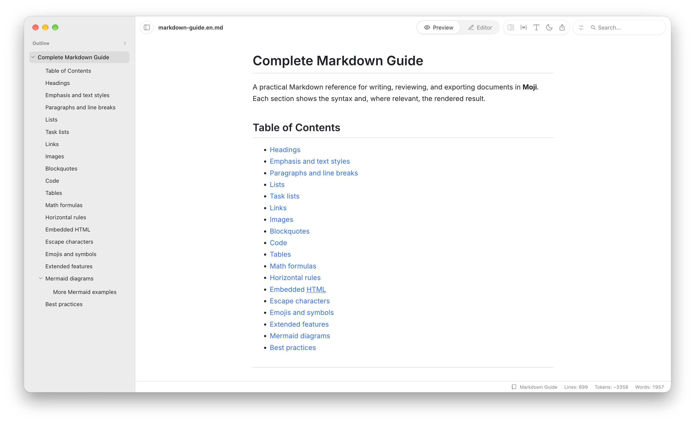

<p align="center">
  
</p>

<h1 align="center">Moji+</h1>

<p align="center"><em>In Japanese, <strong>moji</strong> (文字) means "character", "letter" or "written symbol".</em></p>

<p align="center">A lightweight, clean desktop app for opening, reading, editing, and exporting Markdown files, on macOS, Windows, and Linux.</p>

<p align="center"><strong>Current version:</strong> v1.3.0</p>

<p align="center">
  <picture>
    <source media="(prefers-color-scheme: dark)" srcset="docs/plus/screenshot-dark.png" />
    <source media="(prefers-color-scheme: light)" srcset="docs/plus/screenshot-light.png" />
    
  </picture>
</p>

<p align="center">
  <strong>Download v1.3.0:</strong>
  <a href="https://github.com/jacbmelo/Moji/releases/download/v1.3.0/Moji-Plus.Setup.1.3.0.exe">Windows</a>
  ·
  <a href="https://github.com/jacbmelo/Moji/releases/download/v1.3.0/Moji-Plus-1.3.0-universal.dmg">macOS (DMG)</a>
  ·
  <a href="https://github.com/jacbmelo/Moji/releases/download/v1.3.0/Moji-Plus-1.3.0-x86_64.AppImage">Linux (AppImage)</a>
  ·
  <a href="https://github.com/jacbmelo/Moji/releases/download/v1.3.0/Moji-Plus-1.3.0-amd64.deb">Linux (DEB)</a>
</p>

<p align="center">
  <a href="https://github.com/jacbmelo/Moji/releases">Other downloads and earlier versions on GitHub Releases</a>
</p>

## Features

### Reading and writing

- **Preview**: sanitized Markdown with tables, task lists, footnotes, definition lists, subscript and superscript, highlight and insert marks, emoji shortcodes, KaTeX math (`$…$` and `$$…$$`), linkified URLs, syntax-highlighted code with copy buttons, and YAML front matter shown as a highlighted block.
- **Mermaid diagrams and images**: every fenced `mermaid` block renders as a diagram (flowcharts, sequence, Gantt, class, ER, state, journey). Click a diagram or image to inspect it with zoom, drag, a minimap, and PNG export.
- **Editor**: CodeMirror 6 with line numbers, undo history, wrapping, and Markdown formatting shortcuts.
- **Live preview**: a resizable split view keeps the rendered document beside the source while you edit, scrolling both panes together.
- **Outline**: a collapsible heading tree in preview and editor, which follows your reading position and can be navigated with the arrow keys.
- **Search and replace** across the visible text, with the active match and the match count.
- **Markdown guide**: a localized reference opened from the status bar, with each example's source beside its result.

### Documents and sessions

- **Tabs** for several documents, with close others, close to the right, close saved, and close all.
- **Session restore**: Moji+ reopens the tabs from last time, in the same order, each at the place where it was read, in the mode and layout you left.
- **Nothing lost**: new documents and unsaved changes are kept as recovery drafts between sessions; undoing every edit clears the unsaved-changes mark.
- **Changes made by other apps**: an open file changed elsewhere reloads automatically, or, when it has unsaved edits or was deleted, Moji+ asks what to do. Saving never overwrites a change made elsewhere without asking.
- **Large files** stream in and render incrementally; very large documents keep only the visible part on screen.
- **Recent files** on the Welcome screen.

### Export

- **PDF, HTML, and PNG**, with page size and orientation for PDF. Diagrams are embedded as SVG; exports can be cancelled and never leave a partial file.

### Interface

- **A native Mac interface, on every platform**: following Apple's Human Interface Guidelines, with the layout of Safari and Finder: a full-height sidebar, a single-row translucent toolbar with its controls in capsules and the document scrolling under it, Safari-style tabs shown with two or more documents, and the system font, colors, and accent color.
- **macOS**: a full menu bar with every command and its shortcut, native overlay scrollbars, and the standard About panel. Find and Replace is ⌥⌘F and leaving the editor with the keyboard is ⌃M, so ⌘H and ⌘M keep hiding and minimizing the app.
- **Windows and Linux**: the same layout, with the app menu behind a ☰ button in the top-left corner and the native window controls at the right of the toolbar.
- **Native dialogs and menus**: context menus with spelling suggestions, native alerts for unsaved and external changes, Export as a sheet over the document, and Settings in a window of its own.
- **Light and dark themes** for the whole app, following the system or chosen in Settings; exports are always light.
- **15 languages**: English (US and UK), Portuguese (Portugal and Brazil), Spanish, French, German, Italian, Dutch, Arabic, Hindi, Japanese, Chinese (Simplified and Traditional), and Russian.
- **Keyboard and accessibility**: shortcuts for every common action (listed in Settings), a visible focus ring, and support for reduced motion and increased contrast.

### Security

- Sandboxed renderer with context isolation, sanitized HTML, local images limited to the folders of documents you opened, and external links opened in your browser.

## Installation

Download the file for your system from the links above or from [GitHub Releases](https://github.com/jacbmelo/Moji/releases/latest).

| System | File |
|---|---|
| macOS (Apple silicon and Intel) | `Moji-Plus-<version>-universal.dmg` |
| Windows (x64) | `Moji-Plus.Setup.<version>.exe` |
| Linux (x64) | `Moji-Plus-<version>-x86_64.AppImage` or `Moji-Plus-<version>-amd64.deb` |

### macOS

The app is not signed with an Apple Developer ID, so macOS blocks it the first time and may say it is damaged or cannot be checked. The app is fine.

1. Open the DMG and drag **Moji Plus** into the **Applications** folder.
2. Open **Moji Plus**. When macOS blocks it, close the dialog.
3. Open **System Settings > Privacy & Security**, scroll to **Security**, and click **Open Anyway** next to the message about Moji Plus.
4. Confirm. macOS remembers the choice for this version.

On macOS 15 (Sequoia) and later, Control-clicking the app and choosing *Open* no longer skips the check. Instead of steps 2–4 you can clear the quarantine flag in Terminal:

```bash
xattr -dr com.apple.quarantine "/Applications/Moji Plus.app"
```

### Windows

Run `Moji-Plus.Setup.<version>.exe`. The installer is not signed, so Windows SmartScreen may show "Windows protected your PC": click **More info**, then **Run anyway**.

The installer is per user and needs no administrator rights. By default it installs to `%LOCALAPPDATA%\Programs\Moji Plus`, and it lets you choose another folder. It adds Start menu and desktop shortcuts and associates `.md` and `.markdown` files with Moji+.

### Linux

**AppImage** (any distribution, no installation):

```bash
chmod +x Moji-Plus-<version>-x86_64.AppImage
./Moji-Plus-<version>-x86_64.AppImage
```

**deb** (Debian, Ubuntu and derivatives):

```bash
sudo apt install ./Moji-Plus-<version>-amd64.deb
```

The deb package installs the app to `/opt/Moji Plus`, the `moji-plus` command, a menu entry, and the icons.

## Updating

- **Windows**, **macOS**, and **Linux AppImage**: Moji+ checks GitHub Releases. When a newer version exists, it shows a notice with a link to the release page, where you download the new file. On macOS, drag the new app into **Applications** to replace the old one; because the app is not signed, macOS asks you to allow it again (see [macOS](#macos)).
- **Linux deb**: there is no update check. Download the new deb from GitHub Releases and install it over the current version.

Your settings are kept.

## Uninstalling

Removing the app keeps your settings and recovered drafts. To remove them as well, see [Removing settings and data](#removing-settings-and-data).

- **macOS**: quit Moji+ and move `/Applications/Moji Plus.app` to the Trash.
- **Windows**: **Settings > Apps > Installed apps**, find **Moji Plus**, and choose **Uninstall**. You can also run `Uninstall Moji Plus.exe` from the installation folder.
- **Linux AppImage**: delete the `.AppImage` file.
- **Linux deb**: `sudo apt remove moji-plus`.

### Removing settings and data

Moji+ keeps all its data in one folder per user, `moji-plus`:

| System | Settings and data | Update cache |
|---|---|---|
| macOS | `~/Library/Application Support/moji-plus` | none |
| Windows | `%APPDATA%\moji-plus` | `%LOCALAPPDATA%\moji-plus-updater` |
| Linux | `~/.config/moji-plus` (and `~/.cache/moji-plus`, if present) | `~/.cache/moji-plus-updater` (AppImage) |

The folder contains:

- `settings.json`: preferences, window size, position and maximized state, theme, language, recent files, the last folder used, the view mode and outline, and the tabs of the last session with each one's reading position.
- `drafts/`: recovery copies of untitled documents that were never saved to a file, and of unsaved changes to files.
- Electron and Chromium caches (`Cache`, `GPUCache`, `Local Storage`, and others).

> **Deleting the folder permanently removes the recovered drafts.** Save any untitled document, and any file with unsaved changes, that you want to keep before you delete it.

Quit Moji+ first, then:

**macOS**

```bash
rm -rf ~/Library/Application\ Support/moji-plus
# macOS may also have created these; remove them if they exist:
rm -f ~/Library/Preferences/com.jacbmelo.mojiplus.plist
rm -rf ~/Library/Saved\ Application\ State/com.jacbmelo.mojiplus.savedState
rm -rf ~/Library/Caches/com.jacbmelo.mojiplus
```

**Windows** (PowerShell)

```powershell
Remove-Item -Recurse -Force "$env:APPDATA\moji-plus", "$env:LOCALAPPDATA\moji-plus-updater" -ErrorAction SilentlyContinue
```

**Linux**

```bash
rm -rf ~/.config/moji-plus ~/.cache/moji-plus ~/.cache/moji-plus-updater
```

## Requirements

- Node.js `^20.19.0 || >=22.12.0`
- npm

## Development

```bash
npm install
npm run dev
npm run verify
```

- `npm run verify`: TypeScript checks plus `scripts/check-branding.cjs`, which checks how the app is named in its texts and links.
- `npm run dist`, `dist:win`, `dist:linux`, `dist:mac`: package the app into `release/`.

## History and the original Moji

Moji+ began as a fork of **[Moji](https://github.com/alexishida/Moji)**, created by **[Alex Ishida](https://github.com/alexishida)** and distributed under the MIT License. Almost all of its code, design, and translations come from the original application, and Moji+ keeps merging the changes made there. Its official name is **Moji Plus**, written Moji+; the “+” stands for the changes it maintains on top of Moji. All credit for the original application goes to its author; see [CREDITS.md](CREDITS.md).

Moji+ has its own name, version, and releases, and installs next to the original Moji without sharing settings or recovery drafts:

| | Moji | Moji+ |
|---|---|---|
| Repository | [alexishida/Moji](https://github.com/alexishida/Moji) | [jacbmelo/Moji](https://github.com/jacbmelo/Moji) |
| App ID | `com.alexishida.moji` | `com.jacbmelo.mojiplus` |
| Settings folder | `moji` | `moji-plus` |
| Updates | alexishida/Moji releases | jacbmelo/Moji releases |

The current version is based on Moji v1.0.7. On top of it, Moji+ adds:

- An interface following Apple's Human Interface Guidelines, the same on macOS, Windows, and Linux, with a native menu bar on macOS and an app menu button on Windows and Linux.
- Native context menus, alerts, an Export sheet, and a Settings window.
- App-wide light and dark themes, and YAML front matter.
- Session and layout restore, recovery of unsaved changes to files, and per-document reading positions.
- Detection of changes made to open files by other applications.
- Keyboard and accessibility improvements, and its own icon.

Every change is listed in [CHANGELOG.md](CHANGELOG.md); the original README and changelog are kept in [docs/upstream/](docs/upstream/).

### Keeping up with the original Moji

The original repository is configured as the `upstream` remote:

```bash
git remote add upstream https://github.com/alexishida/moji.git   # once
scripts/sync-upstream.sh
```

The script merges `upstream/main` into a `sync/upstream-<date>` branch, refreshes the copies in `docs/upstream/`, records the base version in `package.json` (`upstreamVersion`), and runs `npm run verify`. The full workflow, including how to publish a Moji+ release, is in [.ai-framework/FORK.md](.ai-framework/FORK.md).

The settings folder of the original Moji is `moji`, not `moji-plus`: removing Moji+ data never touches it.

## Credits and license

- Moji+: João Melo, [github.com/jacbmelo/Moji](https://github.com/jacbmelo/Moji)
- Original application: **Moji** by **Alex Ishida**, [github.com/alexishida/Moji](https://github.com/alexishida/Moji)

MIT © Alex Ishida (Moji) · MIT © João Melo (Moji Plus modifications). See [LICENSE](LICENSE) and [CREDITS.md](CREDITS.md).
